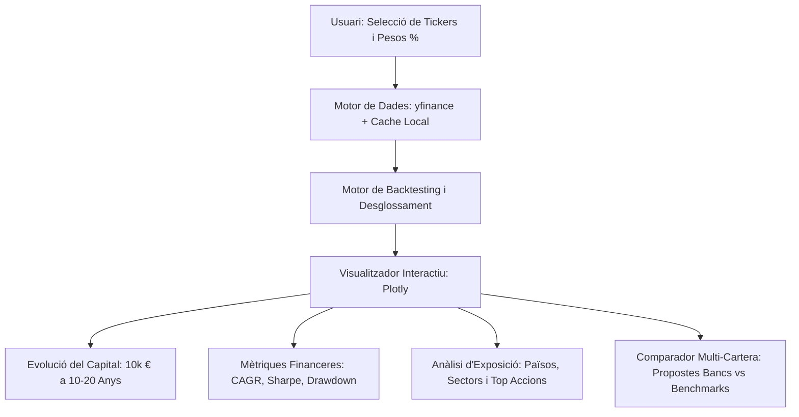

# Proposta de Projecte: Eina Visual de Backtesting i Comparació de Carteres d'Inversió

## 1. Visió General de l'Eina

L'objectiu principal és construir una aplicació visual interactiva que permeti als inversors crear carteres d'actius financers (ETFs, fons d'inversió i accions), simular el seu comportament històric durant els últims 10 a 20 anys utilitzant dades reals de mercat (`yfinance`), analitzar la composició interna (països, sectors i principals accions individuals) i comparar directament diferents propostes d'inversió (per exemple, carteres recomanades per diferents entitats bancàries o combinacions pròpies).



---

## 2. Tecnologies Proposades

Per oferir una eina potent, visualment atractiva i ràpida de desenvolupar i mantenir, es proposa el següent stack tecnològic:

| Component | Tecnologia Recomanada | Justificació |
| :--- | :--- | :--- |
| **Framework de la interfície** | **Streamlit** (Python) | Permet una interfície web moderna i neta, reactiva i fàcil d'executar (`streamlit run app.py`). No requereix mantenir un frontend i backend separats. |
| **Gràfics interactius** | **Plotly** | Gràfics financers d'alta resolució, interactius (zoom, selectors de rang temporal, tooltips detallats amb valors en € i %, gràfics de barres i donuts). |
| **Font de dades financeres** | **`yfinance`** | Accés directe a sèries temporals històriques de cotitzacions ajustades per dividends i splits (ETFs europeus i americans, accions i fons indexats), a més de dades de composició d'ETFs. |
| **Processament de dades** | **Pandas & NumPy** | Càlcul ràpid de retorns compostos, matrius de covariància, rebalançament i mètriques de rendiment. |
| **Persistència de carteres** | **JSON / SQLite** | Guardar, exportar i carregar carteres creades per a no haver de reintroduir els actius cada vegada. |
| **Memòria cau (Caching)** | **SQLite / Parquet local** | Evita descarregar repetidament les mateixes dades de Yahoo Finance, millorant la velocitat i evitant bloquejos per excés de peticions (*rate limits*). |

---

## 3. Mòduls i Funcionalitats Clau

### Mòdul 1: Creador i Gestor de Carteres (*Portfolio Builder*)
* **Cerca i selecció d'actius**:
  * Introducció de símbols de cotització (Tickers), p. ex.: `IWDA.AS`, `VUAA.L`, `CSPX.AS`, `AAPL`, `MSFT`.
  * Llista d'exemples i ETFs habituals predefinits per facilitar la prova ràpida (MSCI World, S&P 500, Emergents, Renda Fixa Global).
* **Assignació de ponderacions (%)**:
  * Control lliscant (*slider*) o camp numèric per a cada actiu.
  * Comprovació automàtica de la suma dels percentatges (avís visual si no suma exactament el 100%).
* **Paràmetres d'inversió inicial**:
  * **Capital inicial configurable**: Per defecte 10.000 € (amb opció de canviar la moneda a $ o €).
  * **Aportacions periòdiques (DCA - Opcional)**: Possibilitat d'afegir aportacions mensuals/trimestrals (ex: 200 €/mes).
  * **Tipus de rebalançament**:
    1. *Buy & Hold* (sense rebalançament: els actius guanyadors pesen cada vegada més).
    2. *Rebalançament periòdic* (anual o semestral, per tornar als percentatges objectiu).
* **Gestió de carteres guardades**:
  * Guardar la cartera actual amb un nom (p. ex., *"Proposta Banc Santander"*, *"Proposta CaixaBank Moderat"*, *"Cartera Indexada Pròpia"*).
  * Llista desplegable per carregar o eliminar carteres desades prèviament.

---

### Mòdul 2: Anàlisi i Visualització Històrica (*Backtesting Viewer*)
* **Horitzó temporal flexible**:
  * Selectors ràpids: **5 anys**, **10 anys**, **15 anys**, **20 anys** o **Rang personalitzat** (dates d'inici i final).
* **Gestió d'actius amb històric limitat**:
  * Si un ETF es va crear fa només 8 anys i es demana una simulació de 15 anys, l'eina detectarà automàticament la data comuna mínima i avisarà clarament a l'usuari, ajustant el període d'anàlisi de forma transparent.
* **Gràfic d'evolució del capital**:
  * Gràfic de línies interactiu que mostra l'evolució del valor de la cartera en euros al llarg del temps.
  * Possibilitat de comparar la corba de la cartera amb la corba del capital aportat (ideal si s'activa DCA).
* **Gràfic de caigudes (*Drawdown Chart*)**:
  * Gràfic complementari ("underwater plot") que mostra les caigudes percentuals des de màxims històrics, vital per entendre el risc i la volatilitat suportada durant crisis (ex: 2008, 2020, 2022).
* **Composició de la cartera**:
  * Gràfic de pastís/donut que visualitza l'assignació d'actius per categoria o fons.

---

### Mòdul 3: Tauler de Mètriques Financeres (*KPIs Dashboard*)
Per a cada cartera analitzada, es calcularan automàticament els indicadors clau del món financer:

| Mètrica | Explicació per a l'Inversor |
| :--- | :--- |
| **Capital Final (€)** | Valor total de la inversió al final del període. |
| **Retorn Total (%)** | Guany acumulat percentual sobre la inversió inicial. |
| **CAGR (%)** | *Compound Annual Growth Rate*: Taxa de creixement anual compost (rendibilitat mitjana anualitzada). |
| **Volatilitat Anualitzada (%)** | Mesura de les fluctuacions de preu (risc de mercat). |
| **Max Drawdown (%)** | La pèrdua màxima patida des d'un pic fins a un fons en tot el període. |
| **Ràtio de Sharpe** | Rendiment obtingut per unitat de risc assumit (per sobre de la taxa lliure de risc). |
| **Millor Any i Pitjor Any (%)** | Retorn del millor exercici natural vs. el pitjor exercici. |

---

### Mòdul 4: Anàlisi d'Exposició (*Portfolio X-Ray: Països, Sectors i Top Accions*)
Aquest mòdul resol la necessitat de conèixer en detall on estan realment invertits els diners i detectar riscos de concentració o solapament (*overlap*) entre ETFs:

* **1. Exposició Geogràfica (Països i Regions)**:
  * Gràfic interactiu de barres horitzontals o donut que mostra el percentatge efectiu de la cartera per país (p. ex., EUA: 65%, Japó: 6%, Regne Unit: 4%, Mercats Emergents: 10%, etc.).
* **2. Exposició Sectorial (Indústries i Sectors)**:
  * Gràfic visual per sectors econòmics (Tecnologia, Serveis Financers, Salut, Consum Cíclic, Indústria, Energia, etc.).
  * Ajuda a detectar si la cartera té una sobreponderació excessiva (per exemple, més d'un 35% en tecnologia).
* **3. Principals Accions Individuals (*Top Holdings & Overlap*)**:
  * Gràfic amb el Top 10-15 d'accions individuals que componen la cartera agregada.
  * *Exemple clau*: Si es combinen dos ETFs diferents (com un MSCI World i un S&P 500 o un sectorial tecnològic), el sistema calcula el pes acumulat real d'empreses com Apple, Microsoft, NVIDIA, Amazon, Alphabet, etc.
* **Obtenció robusta de dades**:
  * Utilització de les dades de desglossament de `yfinance` (`funds_data`, `top_holdings`, `sector_weightings`).
  * Base de coneixement precarregada per als ETFs i fons més utilitzats a Europa i EUA per garantir gràfics immediats i sense buits d'informació.

---

### Mòdul 5: Comparador de Carteres (*Portfolio Comparison & Benchmarking*)
Aquesta funcionalitat permet enfrontar propostes de diferents entitats financeres:
* **Selecció múltiple**: L'usuari podrà marcar dues o més carteres guardades per analitzar-les juntes (p. ex., *"Proposta Banc A"* vs *"Proposta Banc B"* vs *"Cartera Indexada Personal"*).
* **Afegir Benchmarks automàtics**: Opció de comparar directament contra un índex de referència com l'**S&P 500** (`SPY`) o el **MSCI World** (`URTH` / `IWDA.AS`).
* **Gràfic comparatiu superposat**:
  * Línies de diferents colors mostrant el creixement paral·lel de cada proposta partint del mateix capital inicial (10.000 €).
* **Taula comparativa cara a cara**:
  * Taula resum que enfronta les carteres amb totes les mètriques (CAGR, Volatilitat, Max Drawdown, Valor Final), permetent veure d'un cop d'ull quina proposta ofereix millor rendibilitat o menor risc.
* **Comparació visual d'exposicions**:
  * Gràfic de barres agrupades comparant com es reparteixen els sectors i països entre la Proposta A i la Proposta B.

---

## 4. Estructura del Projecte

```text
etf-tracker/
├── app.py                     # Punt d'entrada de l'aplicació Streamlit (UI principal)
├── config.py                  # Configuracions generals (capital per defecte, llistes d'ETFs populars)
├── requirements.txt           # Dependències del projecte (streamlit, yfinance, plotly, pandas, etc.)
├── core/
│   ├── __init__.py
│   ├── data_fetcher.py        # Descàrrega de dades via yfinance amb sistema de cache
│   ├── portfolio.py           # Model de dades de la cartera i lògica de ponderació
│   ├── backtest_engine.py     # Càlcul de rendibilitats, rebalançament i mètriques (CAGR, Sharpe, Drawdown)
│   ├── metrics.py             # Fórmules financeres
│   └── xray_engine.py         # Càlcul d'exposició a països, sectors i principals accions
├── components/
│   ├── __init__.py
│   ├── portfolio_builder.py   # UI per afegir actius, percentatges i desar carteres
│   ├── chart_views.py         # Gràfics interactius de Plotly (evolució temporal, drawdowns)
│   ├── xray_views.py          # Gràfics visuals de països, indústries i top accions
│   └── comparison_view.py     # UI de comparació de carteres i taula cara a cara
├── storage/
│   ├── __init__.py
│   └── portfolio_storage.py   # Gestió de fitxers JSON per guardar carteres
└── saved_portfolios/          # Directori on es guarden les carteres en format JSON
```

---

## 5. Fases d'Implementació

1. **Fase 1: Nucli de dades, càlcul financer i exposició**
   - Implementació de `data_fetcher.py` per obtenir dades històriques ajustades via `yfinance` amb gestió de cache.
   - Creació del motor de backtesting (`backtest_engine.py`) amb rebalançament i mètriques (CAGR, Sharpe, Drawdown).
   - Creació del motor X-Ray (`xray_engine.py`) per calcular l'exposició agregada per països, sectors i accions.
2. **Fase 2: Interfície de creació de carteres i persistència**
   - Interfície amb selectors d'actius, pesos percentuals, capital inicial (10.000 €) i botó de guardar/carregar.
   - Prova amb actius reals (ETFs mundials, fons indexats, accions).
3. **Fase 3: Visualització interactiva i gràfics X-Ray**
   - Gràfics d'evolució de capital a 5, 10, 15, 20 anys i gràfics de caigudes (*drawdown*).
   - Gràfics de sectors, països i top accions individuals.
4. **Fase 4: Mòdul de comparació de carteres**
   - Pantalla comparativa multi-cartera amb gràfic superposat i taula de mètriques cara a cara.
5. **Fase 5: Validació, refinament i posada en marxa**
   - Verificació de casos límit (actius amb poca història, tractament de dividends, dates festives de borsa).
   - Documentació i instruccions per arrencar l'aplicació localment amb un sol comandament.
